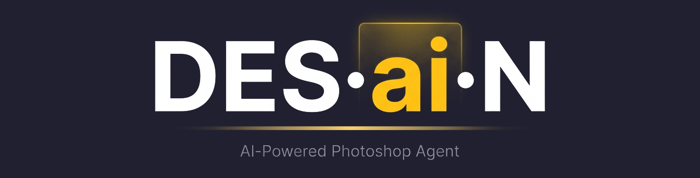

<p align="center">
  
</p>

<h1 align="center">DES.ai.N — AI Control for Adobe Photoshop</h1>

<p align="center">
  An MCP-native Photoshop control plane for AI agents.<br/>
  Connect Claude Desktop, Cursor, or any MCP client — or use the optional desktop design agent.
</p>

<p align="center">
  <a href="https://www.python.org/"></a>
  <a href="https://modelcontextprotocol.io"></a>
  <a href="https://www.adobe.com/products/photoshop.html"></a>
  <a href="https://github.com/mdluex/DES.ai.N/blob/main/LICENSE"></a>
  
</p>

---

## What it is

DES.ai.N (Des-ai-N) lets an AI agent drive Adobe Photoshop through a stable tool
API: open templates, create canvases, edit text and shapes, place imagery, run
Select Subject / Generative Fill, export PNG/PSD/PSB, and manage undo checkpoints.

As of late 2026 the supported agent interface is the **Model Context Protocol
(MCP)**. Photoshop execution goes through a **UXP plugin WebSocket bridge**
(primary, cross-platform), with a **Windows COM / ExtendScript fallback**. A
mock bridge powers CI.

Adobe previewed official local MCP integrations for Creative Cloud at Adobe MAX
(10 Nov 2026), with private beta planned for early 2027. DES.ai.N is aligned with
that direction and uses the open MCP + UXP pattern that is already shipping in
the ecosystem today. Details and citations: [docs/architecture.md](docs/architecture.md).

---

## Demo

<p align="center">
  <video src="https://github.com/mdluex/DES.ai.N/raw/main/explainer.mp4" controls muted playsinline width="720">
    Your browser doesn't support embedded video.
    <a href="explainer.mp4">Download the explainer video</a>
  </video>
</p>

---

## Architecture (short)

```
MCP Client (Claude Desktop / Cursor / …)
    → DES.ai.N MCP server (Python)
        → Bridge Manager
            → UXP WebSocket plugin in Photoshop   (primary)
            → COM / ExtendScript                  (Windows fallback)
            → Mock bridge                         (tests)
```

Full write-up: [docs/architecture.md](docs/architecture.md)

---

## Quick start (one command)

```bash
# macOS / Linux
bash scripts/setup.sh

# Windows
scripts\setup.bat
```

Then:

1. Start the MCP server: `desain-mcp`
2. Load `uxp-plugin/` in Adobe UXP Developer Tool and connect the panel
3. Point Claude Desktop / Cursor at the `desain-mcp` executable

Step-by-step client config: [docs/setup.md](docs/setup.md)

### Optional desktop UI

```bash
python main.py
# Windows: run.bat
```

---

## Supported clients

| Client | Transport | Notes |
|---|---|---|
| **Claude Desktop** | MCP stdio | Add server entry pointing at venv `desain-mcp` |
| **Cursor** | MCP stdio | Same; configure in Cursor MCP settings |
| **Other MCP hosts** | MCP stdio | Any MCP-compatible agent runtime |
| **DES.ai.N desktop UI** | OpenAI-compatible LLM + COM | Windows Photoshop COM path |

---

## Tools / capabilities

Core MCP tools include document open/create/save/close, layer context, text,
shapes, gradients, strokes, image placement (Unsplash or local path), pill CTAs,
Select Subject, Generative Fill, history checkpoint / undo, and status.

Full table: [docs/tools.md](docs/tools.md)

---

## Configuration

Copy `.env.example` → `.env` (setup scripts do this automatically).

| Variable | Purpose |
|---|---|
| `DESAIN_BRIDGE_BACKEND` | `auto` / `uxp` / `com` / `mock` |
| `DESAIN_BRIDGE_PORT` | WebSocket port (default `8765`) |
| `DESAIN_BRIDGE_TIMEOUT_S` | Per-request timeout |
| `DESAIN_HISTORY_CHECKPOINT` | Snapshot before mutations |
| `DESAIN_TEMPLATES_DIR` / `DESAIN_OUTPUT_DIR` | Paths |
| `DESAIN_LLM_BASE_URL` / `DESAIN_LLM_API_KEY` | Desktop agent LLM |
| `DESAIN_LLM_PROVIDER` | `openai_compatible`, `openai`, `groq`, … |
| `UNSPLASH_ACCESS_KEY` | Stock imagery |
| `DESAIN_ALLOW_DESTRUCTIVE` | Enable raw JSX/batchPlay service methods |

Secrets are not committed. Rotate any keys that previously lived in source.

---

## Project structure

```
desain/                 # MCP server, bridges, schemas, plugins loader
uxp-plugin/             # Photoshop UXP WebSocket bridge panel
core/                   # Legacy DesignAgent + COM client (desktop UI)
ui/                     # Optional PyQt shell
utils/                  # templates, unsplash, inspect_psd
plugins/                # User MCP tool plugins
docs/                   # Architecture, setup, tools, troubleshooting
tests/                  # Unit tests + mock bridge
scripts/setup.sh|.bat   # One-command install
```

---

## Development

```bash
bash scripts/setup.sh
source .venv/bin/activate
pytest -q
ruff check desain tests utils core
```

CI runs lint + tests on Python 3.10 and 3.12 (`.github/workflows/ci.yml`).

---

## Roadmap status

### Done in this modernization
- MCP server with typed tool schemas and structured errors
- UXP WebSocket bridge plugin + hub (reconnect on the plugin side)
- Windows COM fallback wrapping the existing Photoshop client
- Mock bridge, unit tests, lint, GitHub Actions CI
- `.env`-based secret management (removed committed keys)
- Cloud / OpenAI-compatible LLM provider resolution for the desktop agent
- Plugin system (`plugins/*.py`) for custom tools
- macOS-capable primary path via UXP (COM remains Windows-only)
- Docs: architecture, setup, tools, troubleshooting, limitations

### Still open
- **Arabic / RTL typography** — prompt + text measurement work remains
- **Multi-line hero font-size estimation** — still heuristic
- **Semantic template matching** (embeddings) — filename/substring matching only
- **Template marketplace** — not started
- **Brand kit support** — not started
- **Web UI alternative to PyQt** — not started
- **Vision rerank for Unsplash** — not started
- **Stable Diffusion / ComfyUI** — not started
- **Adobe official Creative Cloud MCP adapter** — blocked on Adobe private beta (early 2027)

Prioritisation note: reliability (MCP schemas, bridge timeouts, checkpoints,
tests, secret hygiene) landed first. Marketplace / brand kit / web UI are
product expansions that do not improve bridge correctness.

---

## Troubleshooting & limitations

- [docs/troubleshooting.md](docs/troubleshooting.md)
- [docs/limitations.md](docs/limitations.md)

Verification note: this repository’s automated suite does **not** drive a live
Photoshop instance. Validate UXP/COM behaviour on a workstation with Photoshop
installed before production use.

---

## Contributing

1. Fork and branch from `main`
2. Prefer changes that go through `desain/` bridges — do not scatter Photoshop calls
3. Add/adjust unit tests with the mock bridge
4. Update docs when tools or setup steps change
5. Open a focused PR

---

## Commercial use

Commercial use requires prior written permission from the maintainer. See the
license section below and open a GitHub issue titled
`[Commercial License Request]`.

---

## License

Source-Available, Non-Commercial. See [`LICENSE`](LICENSE).

Third-party services (Adobe Photoshop, LLM providers, Unsplash) are governed by
their own terms when used through DES.ai.N.

---

<p align="center">
  <a href="https://github.com/mdluex/DES.ai.N/">Star on GitHub</a>
  ·
  <a href="docs/architecture.md">Architecture</a>
  ·
  <a href="docs/setup.md">Setup</a>
</p>
